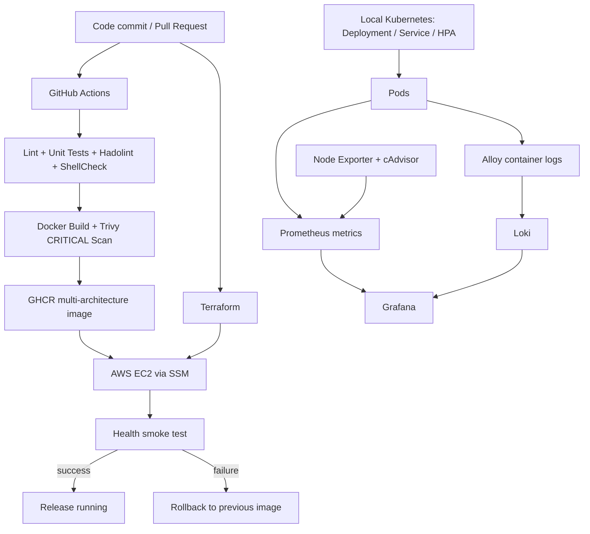

# Care Guide DevOps Engineer Assessment

A small FastAPI service with containerization, CI/CD, Terraform, Kubernetes, observability, and Linux automation.

> **Important:** This repository is a starter implementation. Before submission, replace all placeholders, run the commands in your own environment, fix any environment-specific issues, and add genuine screenshots/evidence. Do not claim AWS deployment or successful CI runs unless you performed them.

## Architecture



## Prerequisites

- Python 3.12
- Git
- Docker Desktop with WSL2 on supported Windows 10/11, or Docker Engine on Linux
- GitHub account
- Optional for cloud deployment: AWS account, AWS CLI, Terraform
- Optional for Kubernetes: kind or minikube, kubectl, metrics-server

## Run locally (Windows PowerShell)

```powershell
py -3.12 -m venv .venv
.\.venv\Scripts\Activate.ps1
python -m pip install --upgrade pip
pip install -r requirements-dev.txt
pytest -v
```

Run the API:

```powershell
uvicorn app.main:app --host 127.0.0.1 --port 8000
```

Open `http://127.0.0.1:8000/`, `/health`, `/metrics`, and `/docs`.

## Docker

```powershell
docker build -t care-guide-api:local .
docker run --rm -p 8080:8000 care-guide-api:local
```

Test `http://localhost:8080/health`.

Compose:

```powershell
Copy-Item .env.example .env
docker compose up --build -d
docker compose ps
docker compose logs -f app
docker compose down
```

The Dockerfile uses a multi-stage build, a pinned Python Alpine tag, a non-root runtime user, labels, and a health check. Record the actual image size after building:

```powershell
docker image ls care-guide-api
docker image inspect care-guide-api:local --format='{{.Size}}'
```

The runtime image uses Alpine rather than distroless to retain a minimal Python runtime and standard Python diagnostics. Re-check the exact resulting size on the target architecture.

## Tests and lint

```powershell
pip install -r requirements-dev.txt
pytest -v
ruff check app tests
```

Dockerfile lint: `hadolint Dockerfile`. Shell lint: `shellcheck scripts/system_health.sh` (run in WSL or a Linux shell).

## Observability stack

Set a strong local Grafana password in `.env` before starting. Never commit `.env`.

```powershell
docker compose -f docker-compose.monitoring.yml up --build -d
```

- Grafana: `http://localhost:3000`
- Prometheus: internal only (not published to host)
- Loki: internal only
- Alloy: internal only
- Node Exporter and cAdvisor: internal only

Prometheus retention is 15 days. Loki retention is 168 hours (7 days). Grafana datasources and dashboards are provisioned from repository files.

Alloy reads Docker container logs through the Docker socket. Access to the Docker socket is highly privileged; use only in a trusted local development environment. Node Exporter mounts the host root read-only. cAdvisor receives host resource mounts and privileged access because it needs container and kernel metrics. These mounts should be reviewed and reduced for production.

### Dashboard walkthrough

1. Application: request rate, error count rate and latency quantiles; use the Loki logs panel alongside the metrics to inspect errors around the spike.
2. Host: CPU, memory, disk and network receive metrics from Node Exporter.
3. Containers: CPU and memory from cAdvisor, including memory relative to the configured limit.

Capture actual screenshots from Grafana and save them under `screenshots/` before submission.

### Investigating an error spike

Start on the Application dashboard and identify when the error rate rises. Compare the time window with request rate and latency percentiles. Open the adjacent Loki panel and filter by `level="ERROR"` or inspect request path/status fields. Correlate the timestamp with container CPU/memory on the Containers dashboard and host pressure on the Host dashboard. Reproduce the failing endpoint, inspect application logs, and verify whether the cause is an application exception, resource pressure, or dependency/network issue.

## Alerts and thresholds

- AppInstanceDown: 1 minute; a missing scrape for a minute is unlikely to be a transient single scrape failure.
- HighApplicationErrorRate: above 5% for 5 minutes; filters short bursts while catching sustained user-visible errors.
- HostDiskUsageHigh: above 80% for 10 minutes; allows time to investigate before the filesystem fills.
- ContainerMemoryNearLimit: above 90% for 5 minutes; warns before likely OOM termination.

Thresholds are initial examples and should be tuned from service baselines.

## Linux health script

Run on Linux/WSL:

```bash
chmod +x scripts/system_health.sh
./scripts/system_health.sh
./scripts/system_health.sh --disk 80 --cpu 90 --mem 85
./scripts/system_health.sh --json
./scripts/system_health.sh --help
```

Exit codes: 0 healthy, 1 warning, 2 critical. Install the systemd unit and timer on a Linux server:

```bash
sudo cp scripts/system_health.sh /opt/care-guide/
sudo cp scripts/health-check.service scripts/health-check.timer /etc/systemd/system/
sudo systemctl daemon-reload
sudo systemctl enable --now health-check.timer
systemctl list-timers health-check.timer
```

The script uses Linux `/proc`, `free`, `df`, and `ps`; it is not a native Windows PowerShell script.

## Kubernetes (kind)

Install kind, kubectl, and metrics-server. Create a cluster:

```bash
kind create cluster --name care-guide
docker build -t care-guide-api:local .
kind load docker-image care-guide-api:local --name care-guide
kubectl apply -f k8s/namespace.yaml
kubectl apply -f k8s/configmap.yaml
kubectl apply -f k8s/deployment.yaml
kubectl apply -f k8s/service.yaml
kubectl apply -f k8s/hpa.yaml
kubectl -n care-guide rollout status deployment/api
kubectl -n care-guide port-forward service/api 8080:80
```

Before applying, edit `k8s/deployment.yaml` image to `care-guide-api:local` for the local kind test. Create a local Secret from a file or command; do not commit secret values. The sample `secret.example.yaml` is illustrative only.

Rolling update and rollback:

```bash
kubectl -n care-guide set image deployment/api api=care-guide-api:v1.0.1
kubectl -n care-guide rollout status deployment/api
kubectl -n care-guide rollout history deployment/api
kubectl -n care-guide rollout undo deployment/api
```

HPA requires metrics-server. Ingress requires an ingress controller; port-forward is the documented alternative.

### Production on EKS

Use an ingress controller such as AWS Load Balancer Controller, external secrets via AWS Secrets Manager and External Secrets Operator, IRSA or EKS Pod Identity for workload permissions, managed node groups or Karpenter for node autoscaling, ECR for images, and CloudWatch/Prometheus-compatible monitoring. Use private subnets and controlled ingress.

## Terraform / AWS

**Cost and billing warning:** AWS resources may incur charges. Set a budget alert first. Destroy test resources after collecting evidence.

The Terraform example uses the default VPC, EC2, an instance profile with SSM and CloudWatch managed policies, encrypted gp3 root volume, and a CloudWatch log group. It deliberately uses SSM rather than opening SSH by default. The example app security group exposes port 8080; restrict it to a load balancer or trusted CIDR for production.

The S3 backend must be bootstrapped separately. Create a unique S3 bucket, enable versioning and encryption, then copy `backend.example.tf` to `backend.tf` and replace the bucket name. Terraform S3 native lockfile requires Terraform 1.10+. Never commit state files.

```bash
cd terraform
terraform init
terraform fmt -check
terraform validate
terraform plan -var-file=staging.tfvars
terraform apply -var-file=staging.tfvars
terraform destroy -var-file=staging.tfvars
```

Get a current Amazon Linux 2023 AMI ID for your chosen region and set it in the tfvars file. Review every plan before apply. A successful plan is not evidence of a successful apply; capture genuine output if you deploy.

## CI/CD configuration

PR workflow runs lint, tests, Dockerfile and shell lint, image build, and Trivy CRITICAL scan. Main workflow builds and pushes `linux/amd64` and `linux/arm64` images to GHCR with SHA and branch/tag references and GitHub Actions layer cache.

For AWS deployment, configure GitHub OIDC:
- `AWS_DEPLOY_ROLE_ARN` repository secret.
- `AWS_REGION` repository variable.
- `EC2_INSTANCE_ID` repository variable.
- IAM trust policy restricted to this repository and `main` branch.
- EC2 instance must have SSM agent, Docker, and network access to pull the image.
- Make the GHCR image public or configure authenticated image pull on EC2.

Review the release workflow and test it in a disposable environment before relying on it. Do not add static AWS keys.

## Deployment and rollback strategy

The intended pipeline builds an immutable SHA-tagged image, scans it, pushes it, then uses SSM to run a deployment script. The script pulls a candidate image, checks `/health`, and restores the previous image if the check fails. A production-grade deployment should use a reverse proxy or load balancer and blue/green target switching to avoid a brief interruption during container replacement.

## Security considerations

- No credentials are committed. Use GitHub secrets/OIDC and Kubernetes Secrets or an external secrets manager.
- Trivy blocks CRITICAL vulnerabilities.
- EC2 uses an instance profile; no static AWS access keys.
- Restrict network ingress; only expose the application or load balancer and Grafana locally.
- Run application as non-root; Kubernetes uses read-only root filesystem and drops Linux capabilities.
- Protect Docker socket access and host mounts in monitoring agents.
- Pin image tags and review updates regularly.

## Estimated AWS monthly cost

A small always-on EC2 instance, EBS storage, CloudWatch Logs, S3 state storage, and data transfer can cost roughly USD 10–30/month depending on region, instance type, free-tier eligibility, log volume, and traffic. This is a planning estimate, not a quote. Check the AWS Pricing Calculator before creating resources. EKS would add substantial control-plane cost and is intentionally not used for this assessment.

## Design decisions

- **FastAPI:** quick API implementation with automatic OpenAPI docs and simple testing.
- **Alpine vs distroless:** Alpine keeps the image relatively small while retaining common runtime diagnostics; distroless could reduce attack surface further but makes debugging harder.
- **EC2 vs ECS/EKS:** EC2 demonstrates Terraform, IAM, SSM, and host operations with less complexity. Kubernetes is demonstrated locally as requested.
- **Tags:** immutable commit SHA plus semantic version/tag; never rely on `latest`.
- **Secrets:** environment injection, GitHub secrets, OIDC, Kubernetes Secret pattern; no committed secret values.
- **Log labels:** level and environment are bounded labels; request path is retained in the log body rather than promoted to a high-cardinality label.

## What I would improve with more time

Add integration tests, dependency pinning with hashes, SBOM and image signing, automated IaC scanning, blue/green EC2 deployment behind an ALB, TLS, external secrets, alert routing, distributed tracing, and load testing.

## AI tool usage

AI assistance was used to help structure the implementation, draft configuration examples, and explain DevOps concepts. All code and configuration must be reviewed, executed, tested, and understood by the candidate before submission.

## Submission checklist

- [ ] Replace image name and repository placeholders.
- [ ] Run tests and attach actual test output.
- [ ] Build image and record actual image size.
- [ ] Run local Compose and monitoring stack.
- [ ] Capture all three Grafana dashboard screenshots.
- [ ] Run Kubernetes rollout and rollback and record output.
- [ ] Run ShellCheck and Terraform validate/plan.
- [ ] Deploy AWS only if account/budget allows; otherwise clearly state it was not applied and provide plan output.
- [ ] Check GitHub Actions runs and ensure CRITICAL scan passes.
- [ ] Remove `.env`, credentials, Terraform state, and any real secrets before pushing.
- [ ] Confirm repository access is public or shared with reviewers.
